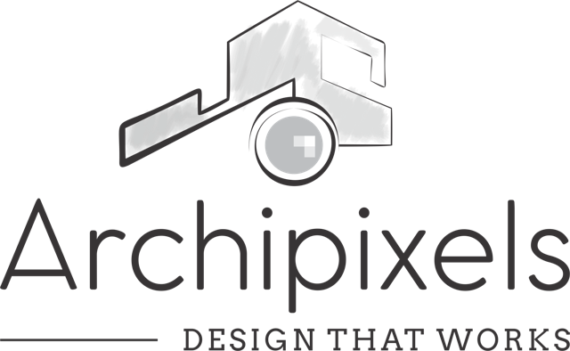
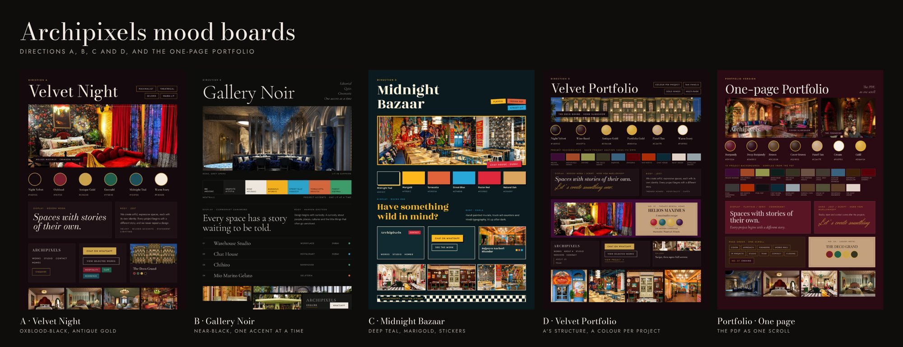

<div align="center">

<picture>
  <source media="(prefers-color-scheme: dark)" srcset="docs/logo-dark.png">
  
</picture>

# Archipixels website templates

**Static design templates for the Archipixels architecture and interior studio, Lucknow**

Four complete website directions (A, B, C and D) and a one-page portfolio, built from the studio's PDF portfolio with the same 19 projects and the same content in each. The client reviews them in the browser, picks one, and the site is then built in Laravel (Blade).

[](#folder-layout)
[](#folder-layout)
[](#libraries-and-motion)
[](#libraries-and-motion)
[](#libraries-and-motion)
[](./LARAVEL.md)
[](https://archipixels-template.pages.dev)
[](#before-launch)

</div>

---



## What is in the package

- Directions A, B, C and D, each with 26 pages: Home, About, Studio, Team, Services, Works, Contact and one page for each of the 19 projects.
- A one-page portfolio version, which is the PDF portfolio as a single scrolling page.
- A chooser page (`index.html`) that links to every version, and a small switcher at the bottom left of each page that opens the same page in another direction.
- Mood boards for each direction and for the portfolio version in `moodboards/`.
- Python generators that build every page from the JSON files in `data/`.
- Notes for the Laravel build in [LARAVEL.md](./LARAVEL.md) and rules for Claude Code in [CLAUDE.md](./CLAUDE.md).

The site covers every kind of client the studio serves. Dubai appears in the About story and on the Warehouse Studio and Chat House project pages only.

## Directions

| Folder | Direction | Look |
|---|---|---|
| `a/` | Velvet Night | Oxblood-black and antique gold. Bodoni Moda and Jost. |
| `b/` | Gallery Noir | Near-black with bone-coloured type and one accent colour per project. Cormorant Garamond and Hanken Grotesk. |
| `c/` | Midnight Bazaar | Deep teal, marigold, stickers and hard shadows. Rozha One and Karla. |
| `d/` | Velvet Portfolio | The portfolio look on A's multi-page structure. Bodoni Moda, Jost and Herr Von Muellerhoff. |
| `portfolio/` | One-page portfolio | The PDF as one scroll. Playfair Display, Cormorant Garamond, Jost and Herr Von Muellerhoff. |

## Quick start

The generated pages are already in the repository, so any static server shows them.

```bash
python3 -m http.server 8000
```

Open `http://localhost:8000` and pick a direction. The generators need Python 3 and nothing else. Run them after changing `data/*.json` or a generator:

```bash
python3 tools/build.py            # a/, b/ and c/
python3 tools/build_d.py          # d/
python3 tools/build_portfolio.py  # portfolio/index.html
```

Each command rebuilds only its own folders.

## Direction D

`d/` merges the one-page portfolio with the multi-page structure and style of Direction A. The header menu is Works, About (with About us and Team below it), Studio, Services and Contact.

- Home has a hero slideshow, the approach, the founders, three spotlight projects in their own colours, the works wall and the closing line.
- Works is a filterable wall of all 19 projects.
- Each project page uses A's layout: a full-background hero photo, a facts row, the design language, signature details and story, a colour palette, a gallery slider with a lightbox, related projects and an enquiry call to action. Below the hero, the page takes the project's own colour from `data/portfolio.json`, and the palette sits on D's tan panel. A next-project band follows the gallery. Warehouse Studio has one photo, so its gallery has one slide and no arrows.
- The portfolio PDF (5 MB) is at `assets/downloads/Archipixels-Portfolio.pdf`. D links it from the closing band, the contact page and the footer, and the one-page portfolio links it from the contact section, the index menu and the footer. A, B and C do not link it.
- About, Studio and Services use A's templates and styling. The Studio page keeps one placeholder, `[STUDIO HOURS AND HOW TO BOOK A VISIT]`.
- `tools/build_d.py` builds `d/`. It imports `tools/build.py` for the shared header, footer and pages, and `tools/build_portfolio.py` for the colour helpers. `build.py` has one addition for D, the `SWITCH` list.
- `assets/css/theme-d.css` and `assets/js/theme-d.js` hold the D components and motion. D also loads `theme-a.css` and `theme-a.js`, so its body class is `theme-a theme-d`.
- D reads its photos from `portfolio/img/` and the closing logo from `assets/brand-originals/logo-stacked-light.png`.

## One-page portfolio

`portfolio/index.html` follows the order of the PDF: cover slideshow, approach, founders, a wall of all 19 projects, the 19 project sections (each in the background colour of its PDF page, with a tan panel, colour swatches, design language and signature details), studio, team, contact with an enquiry form and a WhatsApp button, and the closing line.

- `portfolio/css/portfolio.css` and `portfolio/js/portfolio.js` hold the styling and motion.
- `portfolio/img/` holds the photos cut from the PDF.
- `tools/build_portfolio.py` builds the page from `data/site.json`, `data/projects.json` and `data/portfolio.json`. The last file holds each project's background colour, photo list, captions and sampled swatch colours.

## Pages in A, B and C

- `index.html`
- `about.html`, `studio.html`, `team.html`, `services.html`
- `works.html`, a filterable list of 19 projects plus a text list of earlier Lucknow work
- `projects/<slug>.html`, 19 project pages
- `contact.html`

## Folder layout

```text
index.html               chooser for the client preview
a/ b/ c/ d/              one complete site per direction
portfolio/               one-page portfolio (own css, js and img)
assets/css/core.css      layout and components shared by every direction
assets/css/theme-*.css   tokens and styling for each direction (theme-d.css adds to theme-a.css)
assets/js/core.js        nav, works filter, forms, lightbox and the window.AP helpers
assets/js/theme-*.js     motion for each direction
assets/vendor/           GSAP 3.12.5 with ScrollTrigger, Swiper 11.1.4, GLightbox 3.3.0
assets/img/              photos cropped from the portfolio PDF
assets/downloads/        the compressed portfolio PDF for the download buttons
assets/img/brand/        logo variants for the dark themes, favicon and touch icon
assets/brand-originals/  logo files as supplied
moodboards/              mood boards as PNG, with an overview of all five
data/                    site.json, projects.json, portfolio.json, legacy-projects.json
tools/                   build.py, build_d.py, build_portfolio.py
docs/                    logo and preview images used by this README
```

## Docs

| File | Covers |
|---|---|
| [CONTEXT.md](./CONTEXT.md) | The brief, the design language of each direction, the decisions made and the open items |
| [docs/claude-code-prompt.md](./docs/claude-code-prompt.md) | First message for a Claude Code session on this repository |
| [LARAVEL.md](./LARAVEL.md) | How these files map to a Laravel app: layout, partials, routes, data |
| [CLAUDE.md](./CLAUDE.md) | Working rules for Claude Code, the Blade conversion plan and the Laravel build rules |

## Libraries and motion

The templates use no JS framework and no build step. GSAP and ScrollTrigger handle parallax, reveals and the pinned horizontal scroll. Swiper runs the slideshows and GLightbox the gallery lightbox. The libraries are vendored in `assets/vendor/`, and the fonts load from Google Fonts.

The CSS keeps a plain `rgba()` fallback before each `color-mix()` and a `-webkit-` prefix beside `backdrop-filter`, so the header and hero overlays also work on iOS 15 Safari.

Motion respects `prefers-reduced-motion`. Only JavaScript hides content before an animation, so the pages stay readable when scripts fail.

## Mood boards

`moodboards/` holds a 1620 x 2340 px board for each direction (A, B, C and D) and for the one-page portfolio. Each board shows the palette, type, components and photos of that version. `moodboards-overview.png` puts all five side by side. The site does not use the boards.

## Logo

The supplied logos have a transparent white version for each dark theme in `assets/img/brand/`: horizontal in the header, stacked in the footer. The favicon and touch icon come from the mark. The white versions were derived from the supplied files, so replace them if the studio has a native white or reversed logo.

## Laravel build

The templates are the design reference for the Laravel site. The Laravel project follows the developer's own conventions, so read its `CLAUDE.md` and `composer.json` before adding code to it. [LARAVEL.md](./LARAVEL.md) lists the layout, partials, routes, models and seed data that the templates imply.

## Before launch

- Confirm the contact details. The portfolio gives `1/146, Gomti Nagar, Lucknow` and `hello@archipixels.com`. The old Wix site gave `B-2, 1222, DLF MyPad, Vibhuti Khand, Gomtinagar` and `info@archipixels.com`. The templates use the portfolio values.
- Fill the placeholders, which show with a dashed underline: `[YEAR]`, `[AREA IN SQ FT]`, `[LOCATION]` and `[PROJECT STORY]` on each project page, `[ROLE]` and `[SHORT BIO]` for each founder, the team member cards, `[STUDIO HOURS AND HOW TO BOOK A VISIT]` on the studio page and `[TURNKEY EXAMPLES]` on the services page.
- Write the real project stories. The text on each project page comes only from the portfolio facts.
- Check the colour swatches. The names come from the portfolio and the hex values were estimated by eye.
- Delete the `theme-switcher` block from the footer markup.
- Wire the forms to a Laravel route with validation, CSRF and a mail notification. They show a thank-you message and send nothing yet.
- Download the old-site photos. `data/legacy-projects.json` lists seven earlier Lucknow projects with Wix image ids (`https://static.wixstatic.com/media/<id>`). They appear as a text list on the works page.
- Replace the PDF crops, which are about 1000 px wide, with original photos.

Direction D and the portfolio version:

- The photos are cut from the PDF and are 600 to 1,600 px wide. Replace them with the original renders for large screens.
- Project backgrounds for Warehouse Studio, Pixel Pop and Chat House are black in the PDF. The pages use a deep green, near-black and deep blue taken from their palettes.
- The studio and team sections use the PDF photos only. Add individual team members when the client supplies them.
- The closing script line and the photo captions need a check on a device with web fonts loaded.
- Direction D's About page repeats A's story, which mentions Dubai. Check it with the client.
- A's hero caption and pagination share a flex row that squeezes the caption on narrow screens. D has its own fix in `theme-d.css`. `theme-a.css` does not have it.

## Hosting the preview

The repository deploys to Cloudflare Pages with no build step. Set the framework preset to None, leave the build command empty and set the output directory to `/`. A `_headers` file asks search engines not to index the preview. The repository is public, so the photos, studio address and contact details are readable by anyone.
